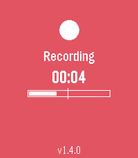
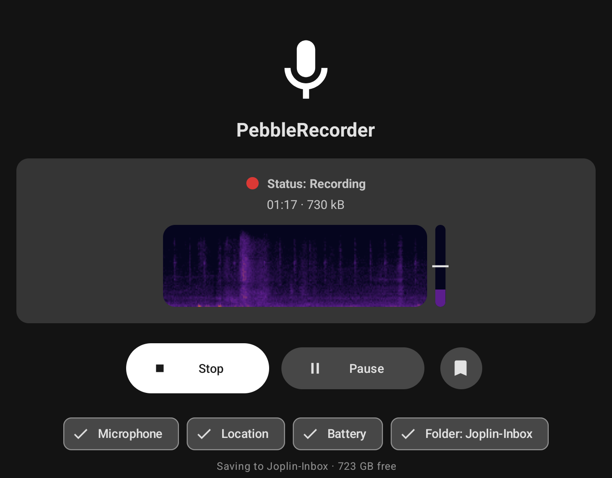
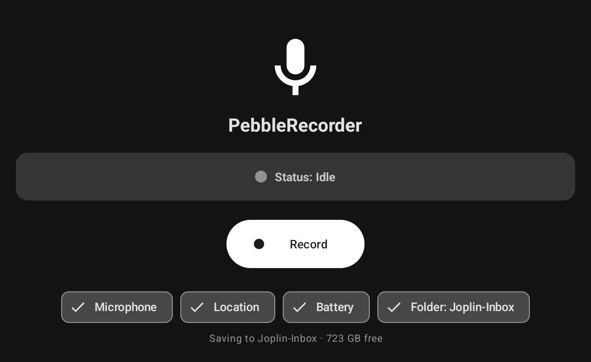

# PebbleRecorder

Use your Pebble watch as a remote start/stop button for audio recording on your
phone. Press a button on the watch and a companion Android app records straight
to a folder you choose — no need to touch your phone.

<p align="center">
  
  
  
</p>

## Features

**On the watch**
- **SELECT** starts and stops a recording, **UP** drops a bookmark at the current timestamp, **DOWN**
  pauses and resumes. On touch watches (e.g. Pebble Time 2) a tap starts and then toggles pause.
- A live timer, and the timer re-syncs if you reopen the app mid-recording.

**Recording**
- Record, pause and stop from the phone too: status card, bookmark button, Quick Settings tile,
  home-screen widget with a record button and timer, and Pause/Stop on the notification.
- Live spectrogram (Android 10+) with a mic level bar. A marker on the bar shows the silence
  threshold used by auto-stop.
- Auto-stop after a set length or after silence. Optional Do Not Disturb while recording.
- Choose the microphone, format (AAC or Opus) and quality under **Show advanced**.
- Recordings stay in private storage until transcription finishes, then the audio and transcript
  appear together in your folder (no half-synced files).

**Transcription and summaries** (all optional)
- Offline Whisper (downloads a model, with a speaker-turn option), Gemini, or OpenAI.
- Summaries from Gemini, OpenAI or Claude.
- Transcripts are saved as a sibling `-txt.md` file, with an optional reverse-geocoded location line.

**Recent recordings**
- Play, share, retry transcription, rename speakers, search, and view the full transcript.
- A storage bar shows how much space your recordings use and how much is left on the device.

**Everything else**
- Optional local webhook (e.g. Pebble Index) to start, stop or toggle recording. Audio sent with a
  request is processed like an in-app recording.
- Settings export and import.
- GitHub builds have a **Check for updates** button. F-Droid builds update through F-Droid.

## How it works

Two apps:

- **`watch/`** — a Pebble watchapp (C). An Idle → Recording → Paused state
  machine with a status icon and a live timer. It has no microphone logic; it
  just sends start/stop/pause and shows whatever status comes back.
- **`android/`** — a native Android app (Kotlin) that does the recording
  (`MediaRecorder`, AAC/M4A or Opus), with optional transcription and summaries.

They don't talk directly. Messages go over Pebble's AppMessage protocol, relayed
by the Pebble/Core companion app:

```
watch app  ◀─AppMessage─▶  Pebble/Core companion app  ◀─AIDL─▶  android app
```

Pebble's SDK has never exposed raw microphone access to watchapps, so all
recording lives on the phone and the watch is just a button.

## Requirements

- A Pebble watch with a phone running a PebbleKit-2 companion app (e.g.
  [Core Devices' app](https://github.com/coredevices/mobileapp)).
- Android 8.0 (API 26) or newer.

## Build

### Watch (`watch/`) — needs the [Pebble SDK](https://developer.repebble.com)

```sh
cd watch
pebble build
pebble install --emulator basalt      # or: --phone <phone-ip>
```

### Android (`android/`)

```sh
cd android
./gradlew :app:assembleGithubDebug
```

Install the APK and grant microphone access. Recordings default to
`Downloads/PebbleRecorder`; pick another folder in the app if you like. It then
runs quietly in the background, armed for the watch trigger.

A real end-to-end test needs both apps **plus** the companion app and a paired
watch — no emulator can exercise the full loop alone. `CLAUDE.md` has the
protocol details, the foreground-service model, and the release checklist.

## Downloads & changelog

`.apk` / `.pbw` artifacts and full release notes:
[Releases](https://github.com/BigWebstas/PebbleRecorder/releases). Also on F-Droid
(reproducible `fdroid` build flavor).
